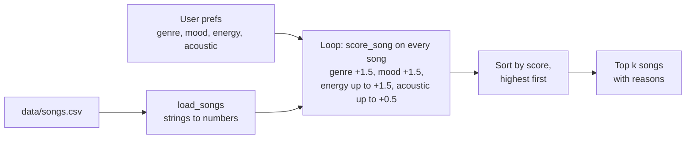

# 🎵 Music Recommender Simulation

## Project Summary

My version is called **VibeJudge 1.0**. It's a small content-based music recommender that runs in the terminal. It reads 20 songs from `data/songs.csv`, gives every song points for how well it matches a listener's favorite genre, mood, energy and acoustic taste, and prints the top 5 with the reason behind every point.

On top of the basic recipe it has:

- optional preferences for mood tags, decade, popularity, instrumental songs and explicit lyrics (Challenge 1)
- four scoring modes you can switch with `--mode` (Challenge 2)
- a diversity penalty with `--diverse`, so the same artist doesn't show up twice (Challenge 3)
- a summary table with `--table` (Challenge 4)

I tested it with four listener profiles and some trick profiles, and wrote down what it gets right and wrong in the [model card](model_card.md).

---

## How The System Works

Before this project I thought Spotify just looked at what genre I listen to. It turns out real platforms mix two ideas. Collaborative filtering looks at what other people with a similar listening history play, skip and add to playlists, so it can suggest songs I would never find on my own. Content-based filtering looks at the song itself (genre, tempo, energy, how "happy" it sounds) and finds tracks that are similar to the ones I already like. Spotify and YouTube use both at the same time, plus a lot of behavior data like skips and watch time. My simulation only has a CSV with 20 songs and no data about other users, so I'm building a content-based recommender. Genre and mood count the same, and after that it looks at how close the song's energy is to what the user wants. I care about "close to" and not "higher", because if someone wants chill music, the most energetic song in the list is the worst pick for them, not the best.

**Song features I use in the score:**

- `genre` - exact match gets full points, a partial match like "pop" and "indie pop" gets half
- `mood` - exact match gets points
- `energy` - compared to the user's target energy
- `acousticness` - small bonus for acoustic songs if `likes_acoustic` is True, or for electronic songs if it's False

`Song` also has `tempo_bpm`, `valence` and `danceability`, but I'm not using them for now. When I looked at the data, tempo, danceability and acousticness go up and down almost together with energy, so adding all of them would basically count energy three or four times. Valence is the only one that actually behaves differently, so I might add it later.

**UserProfile stores:**

- `favorite_genre`
- `favorite_mood`
- `target_energy` (from 0 to 1)
- `likes_acoustic` (True / False)

**The taste profile I test with** (in `src/main.py`):

```python
user_prefs = {
    "favorite_genre": "lofi",
    "favorite_mood": "chill",
    "target_energy": 0.40,
    "likes_acoustic": True,
}
```

This is a late-night study listener. I picked it because the catalog has three lofi songs, so genre alone can't decide the order and mood and energy have to do real work. It should also be easy to tell apart from "intense rock": Storm Runner has the wrong genre, the wrong mood, energy 0.91 and almost no acoustic sound, so it should end up near the bottom of the list.

**Algorithm recipe** (max score is 5.0):

1. Score every song in the catalog. There are no hard filters, so a song with the wrong genre can still win if everything else fits.
2. **Genre:** +1.5 for an exact match, +0.75 for a partial match ("pop" and "indie pop").
3. **Mood:** +1.5 for an exact match.
4. **Energy:** up to +1.5 using `1.5 * (1 - abs(song.energy - target_energy))`.
5. **Acousticness:** up to +0.5. If `likes_acoustic` is True the song gets `0.5 * acousticness`, otherwise `0.5 * (1 - acousticness)`.
6. Sort from highest to lowest score (ties keep the CSV order) and return the top k. The explanation lists which rules gave the song points.

**Advanced features (Challenge 1):** songs also have `popularity`, `release_decade`, `mood_tags`, `instrumentalness` and `explicit`. Each new rule only counts if the profile sets that preference, so my three main profiles still score out of 5.0 exactly like before.

- **Mood tags:** +0.5 for each tag the song shares with the profile's `mood_tags`, up to +1.0. This gives credit for moods that are close but not the same word, like an "euphoric" song tagged "uplifting" for a happy listener.
- **Decade:** +0.5 for the `favorite_decade`, +0.25 for the decade right next to it.
- **Popularity:** up to +0.5 for being close to `target_popularity` (0-100).
- **Instrumental:** up to +0.5, works like the acoustic rule, based on `likes_instrumental`.
- **Explicit:** -1.0 if `allow_explicit` is False and the song has explicit lyrics.

The score is shown out of the best possible score for that profile, so Family Road Trip (High-Energy Pop plus all the new preferences) is out of 7.5.

**Scoring modes (Challenge 2):** the recipe above is the `balanced` mode, and it's the default. You can switch to another ranking strategy with `--mode`. Each mode only changes how much the four main rules are worth, the rules themselves stay the same:

| Mode | Genre | Mood | Energy | Acoustic | Idea |
|---|---|---|---|---|---|
| `balanced` | 1.5 | 1.5 | 1.5 | 0.5 | my recipe, genre and mood count the same |
| `genre-first` | 2.0 | 1.0 | 1.5 | 0.5 | the starter idea, genre counts double |
| `mood-first` | 1.0 | 2.0 | 1.5 | 0.5 | the mood you want beats the genre label |
| `energy-focused` | 0.75 | 1.5 | 3.0 | 0.5 | energy counts double, genre half |

**Diversity penalty (Challenge 3):** with `--diverse`, the top 5 is built one song at a time. Before each pick, a song loses 1.0 point for every song by the same artist that is already in the list, and 0.5 for every song of the same genre. The penalty shows up in the reasons, like "artist already in list: LoRoom (-1.00)". When I tested 2,720 different listeners, the share of top 5 lists with a repeated artist went from 12% to 0%, and lists with 3 or more songs of one genre went from 6% to 0%. The downside: for Chill Lofi, Focus Flow (lofi, and by LoRoom again) drops from #3 to out of the top 5, and the sad Empty Station Blues takes the last spot. So more variety can also mean a slightly worse match, and that's why it's a flag and not the default.

**Why genre and mood are worth the same:** my first plan was +2 for genre and +1 for mood. When I tested it on a few profiles, a "pop, happy" listener got Gym Hero (pop, intense) above Rooftop Lights (indie pop, happy), and a "pop, chill, low energy" listener got the energetic Sunrise City as the #2 pick. Genre is your long-term taste, but mood is what you want right now, so I made them equal. That put Rooftop Lights at #2 and pushed Sunrise City down to #4. I also tried making mood worth more than genre (1 and 2). It helped the "pop + chill" listener even more, but then a genre match was worth less than being 0.67 closer in energy, so I kept them equal.

**My plan (data flow):**



For example, the row `4,Library Rain,...,lofi,chill,0.35,...,0.86` becomes a dict with `energy=0.35`, gets +1.5 (genre) +1.5 (mood) +1.42 (energy) +0.43 (acoustic) = 4.85 for my lofi listener, and ends up #1. The expected top 5 for that profile is Library Rain, Midnight Coding, Focus Flow, Spacewalk Thoughts and Coffee Shop Stories, so I can check my code against it.

**Biases I expect:**

- **Mood is exact-match only.** "relaxed", "peaceful" and "focused" get 0 points, the same as "sad" or "angry". So for my lofi listener the sad Empty Station Blues ranks above the peaceful Moonlit Nocturne, because only energy and acousticness are left to decide.
- **Genre can still beat what the user asked for.** A genre match alone is worth 1.5 points, and the energy rule is forgiving. A "pop, chill, low energy" listener still gets Gym Hero (energy 0.93) in their top 5.
- **Related genres don't count.** The partial match only works when one name contains the other ("pop" and "indie pop"). Lofi and ambient, or r&b and hip hop, are treated as completely unrelated.
- **Small, uneven catalog.** 15 of the 17 genres have only one song, so a metal or folk fan gets one real match and the rest of their top 5 is filled by energy alone. The catalog is also mostly Western genres.
- **Made-up numbers.** The values for songs 11-20 were estimated with AI, not measured, so they may carry stereotypes like "classical is always calm" or "metal is always angry".
- **One genre and one mood per user.** The profile can't describe someone with mixed taste.

---

## Getting Started

### Setup

1. Create a virtual environment (optional but recommended):

   ```bash
   python -m venv .venv
   source .venv/bin/activate      # Mac or Linux
   .venv\Scripts\activate         # Windows

2. Install dependencies

```bash
pip install -r requirements.txt
```

3. Run the app:

```bash
python -m src.main
```

4. Switch the ranking strategy with `--mode` (default is `balanced`):

```bash
python -m src.main --mode mood-first   # balanced, genre-first, mood-first or energy-focused
```

5. Turn on the diversity penalty with `--diverse` (works with any mode):

```bash
python -m src.main --diverse
python -m src.main --mode mood-first --diverse
```

6. Show the results as a summary table with `--table` (works with the other flags too):

```bash
python -m src.main --table
```

### Running Tests

Run the starter tests with:

```bash
pytest
```

You can add more tests in `tests/test_recommender.py`.

---

## Sample Recommendation Output

Output of `python -m src.main` (default `balanced` mode), one block per profile. Every run starts with:

```text
$ python -m src.main
Loading songs from data/songs.csv...
Loaded songs: 20
Scoring mode: Balanced - genre and mood count the same (my recipe)
```

### High-Energy Pop

```text
Top 5 for: High-Energy Pop
  pop / happy / energy 0.80 / prefers electronic
============================================================
 1. Sunrise City by Neon Echo                    4.88 / 5.00
      + genre match: pop (+1.50)
      + mood match: happy (+1.50)
      + energy 0.82 vs your 0.80 (+1.47)
      + acousticness 0.18 (+0.41)
------------------------------------------------------------
 2. Rooftop Lights by Indigo Parade              4.01 / 5.00
      + similar genre: indie pop (+0.75)
      + mood match: happy (+1.50)
      + energy 0.76 vs your 0.80 (+1.44)
      + acousticness 0.35 (+0.33)
------------------------------------------------------------
 3. Gym Hero by Max Pulse                        3.28 / 5.00
      + genre match: pop (+1.50)
      + energy 0.93 vs your 0.80 (+1.30)
      + acousticness 0.05 (+0.47)
------------------------------------------------------------
 4. Concrete Crown by Kilo Verse                 1.93 / 5.00
      + energy 0.78 vs your 0.80 (+1.47)
      + acousticness 0.08 (+0.46)
------------------------------------------------------------
 5. Fuego Lento by Ritmo Solar                   1.93 / 5.00
      + energy 0.80 vs your 0.80 (+1.50)
      + acousticness 0.15 (+0.42)
------------------------------------------------------------
```

### Chill Lofi

```text
Top 5 for: Chill Lofi
  lofi / chill / energy 0.40 / likes acoustic
============================================================
 1. Library Rain by Paper Lanterns               4.85 / 5.00
      + genre match: lofi (+1.50)
      + mood match: chill (+1.50)
      + energy 0.35 vs your 0.40 (+1.42)
      + acousticness 0.86 (+0.43)
------------------------------------------------------------
 2. Midnight Coding by LoRoom                    4.82 / 5.00
      + genre match: lofi (+1.50)
      + mood match: chill (+1.50)
      + energy 0.42 vs your 0.40 (+1.47)
      + acousticness 0.71 (+0.35)
------------------------------------------------------------
 3. Focus Flow by LoRoom                         3.39 / 5.00
      + genre match: lofi (+1.50)
      + energy 0.40 vs your 0.40 (+1.50)
      + acousticness 0.78 (+0.39)
------------------------------------------------------------
 4. Spacewalk Thoughts by Orbit Bloom            3.28 / 5.00
      + mood match: chill (+1.50)
      + energy 0.28 vs your 0.40 (+1.32)
      + acousticness 0.92 (+0.46)
------------------------------------------------------------
 5. Coffee Shop Stories by Slow Stereo           1.90 / 5.00
      + energy 0.37 vs your 0.40 (+1.46)
      + acousticness 0.89 (+0.45)
------------------------------------------------------------
```

### Deep Intense Rock

```text
Top 5 for: Deep Intense Rock
  rock / intense / energy 0.90 / prefers electronic
============================================================
 1. Storm Runner by Voltline                     4.93 / 5.00
      + genre match: rock (+1.50)
      + mood match: intense (+1.50)
      + energy 0.91 vs your 0.90 (+1.48)
      + acousticness 0.10 (+0.45)
------------------------------------------------------------
 2. Gym Hero by Max Pulse                        3.43 / 5.00
      + mood match: intense (+1.50)
      + energy 0.93 vs your 0.90 (+1.46)
      + acousticness 0.05 (+0.47)
------------------------------------------------------------
 3. Afterglow Rush by Pulse Theory               1.92 / 5.00
      + energy 0.95 vs your 0.90 (+1.43)
      + acousticness 0.02 (+0.49)
------------------------------------------------------------
 4. Iron Tide by Black Meridian                  1.88 / 5.00
      + energy 0.97 vs your 0.90 (+1.40)
      + acousticness 0.03 (+0.48)
------------------------------------------------------------
 5. Sunrise City by Neon Echo                    1.79 / 5.00
      + energy 0.82 vs your 0.90 (+1.38)
      + acousticness 0.18 (+0.41)
------------------------------------------------------------
```

### Family Road Trip

```text
Top 5 for: Family Road Trip
  pop / happy / energy 0.80 / prefers electronic
  mood tags: sunny, uplifting, warm
  decade: 2010s
  popularity: 80
  prefers vocals
  no explicit lyrics
============================================================
 1. Sunrise City by Neon Echo                    7.11 / 7.50
      + genre match: pop (+1.50)
      + mood match: happy (+1.50)
      + energy 0.82 vs your 0.80 (+1.47)
      + acousticness 0.18 (+0.41)
      + mood tags: uplifting, sunny (+1.00)
      + from the 2020s, next to your 2010s (+0.25)
      + popularity 82 vs your 80 (+0.49)
      + instrumentalness 0.02 (+0.49)
------------------------------------------------------------
 2. Rooftop Lights by Indigo Parade              6.42 / 7.50
      + similar genre: indie pop (+0.75)
      + mood match: happy (+1.50)
      + energy 0.76 vs your 0.80 (+1.44)
      + acousticness 0.35 (+0.33)
      + mood tags: uplifting, warm (+1.00)
      + from the 2010s (+0.50)
      + popularity 70 vs your 80 (+0.45)
      + instrumentalness 0.10 (+0.45)
------------------------------------------------------------
 3. Gym Hero by Max Pulse                        4.46 / 7.50
      + genre match: pop (+1.50)
      + energy 0.93 vs your 0.80 (+1.30)
      + acousticness 0.05 (+0.47)
      + from the 2020s, next to your 2010s (+0.25)
      + popularity 88 vs your 80 (+0.46)
      + instrumentalness 0.05 (+0.47)
------------------------------------------------------------
 4. Afterglow Rush by Pulse Theory               3.44 / 7.50
      + energy 0.95 vs your 0.80 (+1.28)
      + acousticness 0.02 (+0.49)
      + mood tags: uplifting (+0.50)
      + from the 2010s (+0.50)
      + popularity 85 vs your 80 (+0.47)
      + instrumentalness 0.60 (+0.20)
------------------------------------------------------------
 5. Island Time by Coastline Collective          3.31 / 7.50
      + energy 0.58 vs your 0.80 (+1.17)
      + acousticness 0.40 (+0.30)
      + mood tags: sunny, warm (+1.00)
      + popularity 57 vs your 80 (+0.39)
      + instrumentalness 0.08 (+0.46)
------------------------------------------------------------
```

### Table view (`--table`)

The same results as a table. Every reason gets its own line inside the cell, and long text wraps instead of being cut off. This is the Chill Lofi part of `python -m src.main --table`:

```text
Top 5 for: Chill Lofi
  lofi / chill / energy 0.40 / likes acoustic
+----+--------------------------+--------+--------------------------------------------+
| #  | Song                     | Score  | Reasons                                    |
+====+==========================+========+============================================+
| 1  | Library Rain             |   4.85 | genre match: lofi (+1.50)                  |
|    | by Paper Lanterns        | / 5.00 | mood match: chill (+1.50)                  |
|    |                          |        | energy 0.35 vs your 0.40 (+1.42)           |
|    |                          |        | acousticness 0.86 (+0.43)                  |
+----+--------------------------+--------+--------------------------------------------+
| 2  | Midnight Coding          |   4.82 | genre match: lofi (+1.50)                  |
|    | by LoRoom                | / 5.00 | mood match: chill (+1.50)                  |
|    |                          |        | energy 0.42 vs your 0.40 (+1.47)           |
|    |                          |        | acousticness 0.71 (+0.35)                  |
+----+--------------------------+--------+--------------------------------------------+
| 3  | Focus Flow               |   3.39 | genre match: lofi (+1.50)                  |
|    | by LoRoom                | / 5.00 | energy 0.40 vs your 0.40 (+1.50)           |
|    |                          |        | acousticness 0.78 (+0.39)                  |
+----+--------------------------+--------+--------------------------------------------+
| 4  | Spacewalk Thoughts       |   3.28 | mood match: chill (+1.50)                  |
|    | by Orbit Bloom           | / 5.00 | energy 0.28 vs your 0.40 (+1.32)           |
|    |                          |        | acousticness 0.92 (+0.46)                  |
+----+--------------------------+--------+--------------------------------------------+
| 5  | Coffee Shop Stories      |   1.90 | energy 0.37 vs your 0.40 (+1.46)           |
|    | by Slow Stereo           | / 5.00 | acousticness 0.89 (+0.45)                  |
+----+--------------------------+--------+--------------------------------------------+
```

---

## Experiments You Tried

- **Genre 2 + mood 1 vs. equal weights:** with my first plan (genre 2.0, mood 1.0), a happy pop fan got Gym Hero (intense) above Rooftop Lights (happy), 3.78 vs 3.77, and a "pop but chill" listener got the loud Sunrise City as #2. With genre and mood both at 1.5, Rooftop Lights is #2 and Sunrise City drops to #4. So I kept them equal. You can still try the old version with `--mode genre-first`.
- **Double energy, half genre:** this mostly just swapped songs that were already almost tied. For Chill Lofi, Midnight Coding took #1 from Library Rain (5.54 vs 5.53). It helped a "pop but chill, low energy" listener (the loud songs left the list), but it hurt a "pop but sad, high energy" listener, because the only sad song fell out of the top 5. So it made the results different, not better. It's now `--mode energy-focused`.
- **How fragile is #1?** Library Rain beats Midnight Coding by only 0.03 points, because it sounds more acoustic. If acoustic is worth 0.3 instead of 0.5, or energy is worth 2.5 instead of 1.5, they switch. Making genre worth 3.0 didn't change the #1 song for any profile.
- **Adding valence (tried once, not kept):** a target valence of 0.6 pushed the sad blues song from #6 to #9 for Chill Lofi. That helps, but it didn't fix everything, so I left it as an idea for later.
- **Trick profiles:** one extra space ("Pop ") dropped Sunrise City from 4.88 to 2.63, an energy of 5 made every score negative, "False" typed as text counted as yes, and two inputs (a list of genres, energy as text) crashed the program.
- **Every possible listener:** I ran every combination of genre, mood, energy and acoustic taste (2,720 listeners). Energetic acoustic listeners got a weak #1 song 82% of the time, and two calm acoustic songs showed up in 42% of all top 5 lists, while Iron Tide showed up in only 14%.
- **Diversity penalty:** with `--diverse`, top 5 lists with a repeated artist went from 12% to 0%. But Chill Lofi lost Focus Flow, which was actually a great match.

---

## Limitations and Risks

- **Tiny, uneven catalog:** only 20 made-up songs, and 15 of the 17 genres have just one song. So for most listeners, spots 2 to 5 are picked by energy alone.
- **Exact labels:** "chill" and "relaxed" count as totally different, and so do rock and metal. Mood tags help, but only if the listener sets them.
- **"Calm = acoustic" assumption:** there are no energetic acoustic songs, so people who like those get bad matches.
- **Doesn't understand much:** no lyrics, no language, no listening history, and only one genre and one mood per listener.
- **No input checks:** a space in "Pop ", an energy of 5 or "False" typed as text give wrong results, and some inputs crash it.
- **Popularity bias:** the popularity rule can push songs that are already popular even higher.

More details are in the [model card](model_card.md), section 6.

---

## Reflection

Read and complete `model_card.md`:

[**Model Card**](model_card.md)

A recommender doesn't really "know" music. It turns every song into a few numbers and labels, turns me into a few target values, and then it's just math: add up points for every match and sort the list. What surprised me is how much that already feels like a real app, especially with the reasons under every song. But it also showed me that every number is a choice. Changing genre from 2 points to 1.5 changed which songs people got, so whoever picks the weights is kind of deciding what "a good match" means.

Bias can show up even when nobody writes anything unfair. My code treats everyone the same, but my song list has no energetic acoustic songs, only one song for most genres, and mostly Western music, so some listeners just get worse results. The labels are a problem too: if your mood is called "relaxed" instead of "chill", you get zero points for it. In a real app with millions of users, the same thing could happen to people whose music or language isn't covered well in the data, and they would probably never find out why their recommendations are worse.


